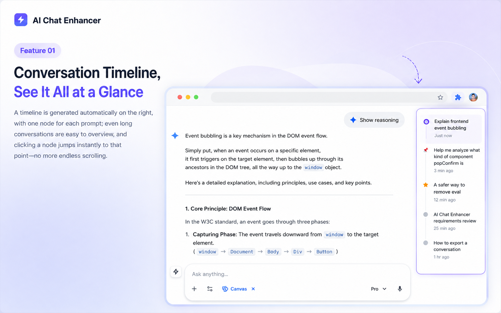
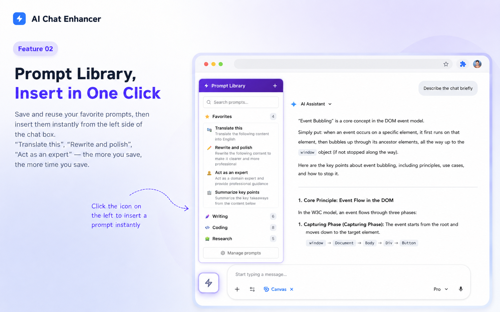
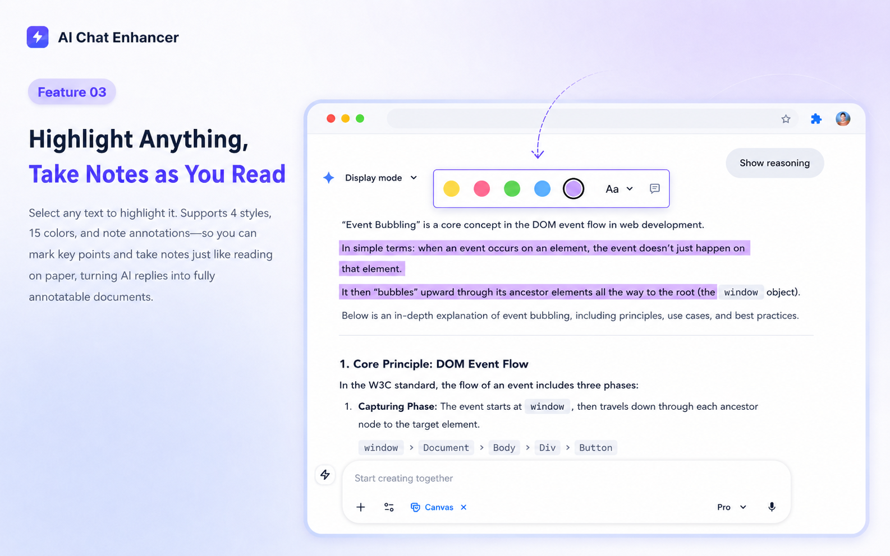
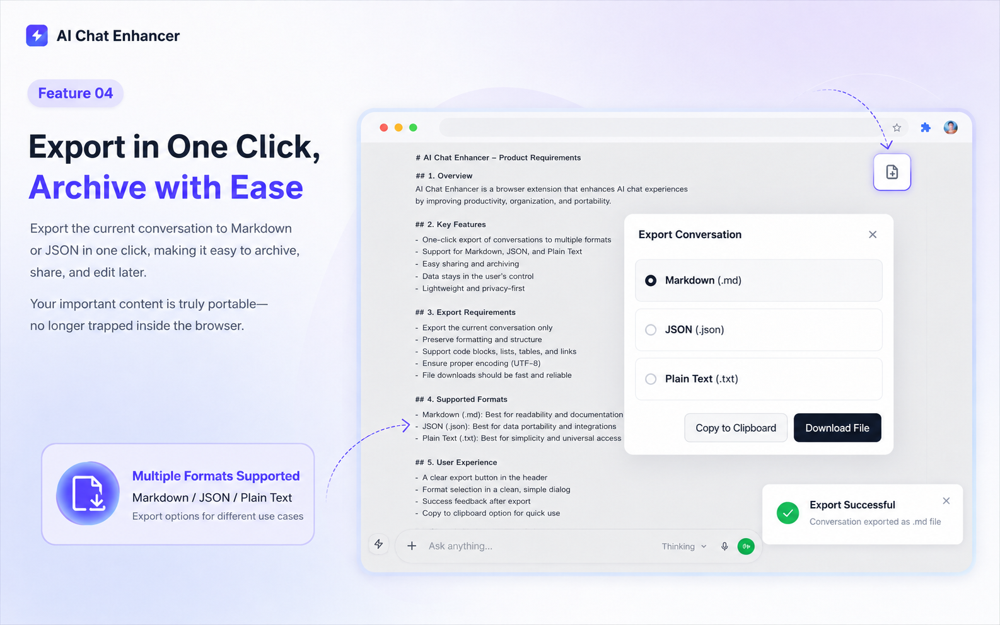
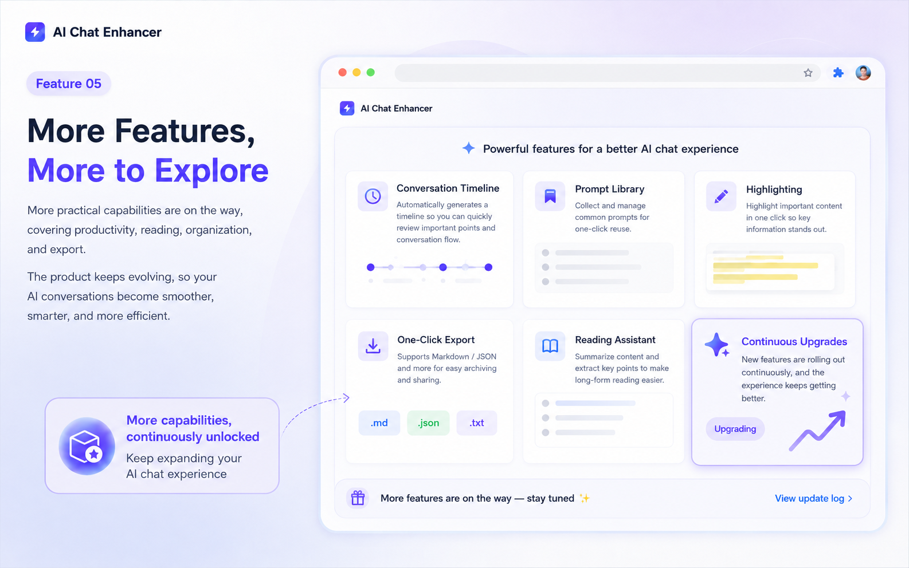

<div align="center">
  
  <h1>ChatLine</h1>
  <p><strong>Navigate, organize, and take your AI conversations with you</strong></p>
  <p>An open-source browser extension that adds timelines, bookmarks, highlights, reusable prompts, and exports to ChatGPT, Gemini, Claude, DeepSeek, and other AI chat sites.</p>

  <p>
    <a href="https://github.com/miguchn/ai-chatline"></a>
    <a href="https://chromewebstore.google.com/detail/chatline-ai-chat-enhanced/oiifmbmllkahpcagifgoedoiinohnfen"></a>
    <a href="https://chromewebstore.google.com/detail/chatline-ai-chat-enhanced/oiifmbmllkahpcagifgoedoiinohnfen"></a>
    <a href="https://chromewebstore.google.com/detail/chatline-ai-chat-enhanced/oiifmbmllkahpcagifgoedoiinohnfen"></a>
    <a href="./LICENSE"></a>
  </p>

  <p>
    <a href="https://chromewebstore.google.com/detail/chatline-ai-chat-enhanced/oiifmbmllkahpcagifgoedoiinohnfen"></a>
    <a href="https://github.com/miguchn/ai-chatline/issues"></a>
  </p>

  <p><a href="./README.md">简体中文</a> · <strong>English</strong></p>
</div>



ChatLine works inside the AI sites you already use. It does not replace their interfaces or require a separate ChatLine account. Install it, open a supported platform, and start chatting; core data stays in your browser by default.

## Contents

- [Why ChatLine](#why-chatline)
- [Core capabilities](#core-features)
- [Supported platforms](#supported-platforms)
- [Screenshots](#screenshots)
- [Quick start](#quick-start)
- [Data & privacy](#privacy)
- [Open source, contributions & roadmap](#open-source)
- [Local development](#development)
- [Current version](#version)
- [Feedback & contact](#feedback)

<a id="why-chatline"></a>

## Why ChatLine

| Common problem | How ChatLine helps |
|---|---|
| Long chats require endless scrolling | Builds a timeline and jumps to any prompt in one click |
| Useful answers get scattered across platforms | Organizes them with bookmarks, folders, highlights, and notes |
| Reusable prompts must be typed again | Saves a prompt library for quick insertion and follow-ups |
| Conversations are hard to archive or reuse | Exports Markdown / JSON and supports local backups |
| Every AI site has a different workflow | Provides one familiar toolkit across major AI platforms |

ChatLine is not another AI chat interface. It fills the navigation, organization, reuse, and archiving gaps in the tools you already use. Lightweight features are enabled by default, advanced tools are opt-in, and the code and data-handling logic are open for inspection.

<a id="core-features"></a>

## Core capabilities

- **Conversation timeline**: Detects prompt nodes automatically for fast navigation, key-point marking, and long-chat review.
- **Bookmarks & organization**: Saves individual items or conversations into nested folders with quick sidebar access.
- **Highlights & notes**: Marks important parts of AI responses with colors and notes while preserving context.
- **Prompts & quick follow-ups**: Stores reusable prompts, inserts them quickly, and carries selected text into the next question.
- **Export, backup & restore**: Exports chats as Markdown / JSON; extension data supports local JSON backups and optional Google Drive sync.
- **Optional enhancements**: Smart input, chat timestamps, page width, LaTeX copying, Mermaid rendering, and code execution can be enabled when needed.

> Timeline, Prompts, Bookmarks, Conversation Export, and Highlights are enabled by default. Code Runner, Mermaid, formula enhancements, digital pets, and AI completion notifications are off by default.

<a id="supported-platforms"></a>

## Supported platforms

ChatLine currently covers 13 AI chat entry points. Text highlighting works across every platform below; other capabilities appear according to each site's page structure.

| AI platform | Timeline | Smart input | Chat export | Sidebar folders |
|---|:---:|:---:|:---:|:---:|
| ChatGPT | ✅ | ✅ | ✅ | ✅ |
| Gemini | ✅ | ✅ | ✅ | ✅ |
| DeepSeek | ✅ | ✅ | ✅ | ✅ |
| Claude | ✅ | ✅ | ✅ | ✅ |
| Kimi | ✅ | ✅ | ✅ | ✅ |
| Doubao | ✅ | ✅ | ✅ | ✅ |
| Qianwen / Qwen Intl | ✅ | ✅ | ✅ | ✅ |
| Grok | ✅ | ✅ | ✅ | — |
| Perplexity | ✅ | ✅ | ✅ | — |
| Yuanbao | ✅ | ✅ | ✅ | — |
| ERNIE Bot | ✅ | — | ✅ | — |
| NotebookLM | — | ✅ | ✅ | — |

| Browser | Installation | Status |
|---|---|---|
| Chrome | [Chrome Web Store](https://chromewebstore.google.com/detail/chatline-ai-chat-enhanced/oiifmbmllkahpcagifgoedoiinohnfen) | Recommended |
| Edge, Brave, Arc, and other Chromium browsers | Chrome Web Store | Supported |
| Firefox 109+ | Build from source and load temporarily | Testing support; no official store release yet |

<a id="screenshots"></a>

## Screenshots

<details>
<summary><strong>View prompt, highlight, export, and additional feature screenshots</strong></summary>
<br>
<table>
  <tr>
    <td width="50%"><br><sub>Prompt management: save and insert reusable instructions</sub></td>
    <td width="50%"><br><sub>Highlights & notes: keep important details in context</sub></td>
  </tr>
  <tr>
    <td width="50%"><br><sub>Conversation export: archive, share, or keep editing</sub></td>
    <td width="50%"><br><sub>More enhancements: opt in without cluttering the default experience</sub></td>
  </tr>
</table>
</details>

<a id="quick-start"></a>

## Quick start

1. Install ChatLine from the [Chrome Web Store](https://chromewebstore.google.com/detail/chatline-ai-chat-enhanced/oiifmbmllkahpcagifgoedoiinohnfen). The same listing works for Edge, Brave, Arc, and other Chromium browsers.
2. Open any supported AI platform. Refresh once if the page was already open before installation.
3. Start a conversation. Most platforms show a timeline on the right; use the lightning button to open the ChatLine feature panel.
4. Enable optional tools such as Quick Follow-up, formulas, Mermaid, Code Runner, or cloud backup when needed.

<a id="firefox-local"></a>
<details>
<summary><strong>Local testing on Firefox 109+</strong></summary>

Firefox currently has a source-compatible build for development and local testing. It has not yet been published to Firefox Add-ons.

```bash
git clone https://github.com/miguchn/ai-chatline.git
cd ai-chatline
node scripts/build-firefox.js
```

Then open `about:debugging`, choose “Load Temporary Add-on,” and load the generated `ChatLine-v4.0.0-firefox.zip`.
</details>

<a id="privacy"></a>

## Data & privacy

- Core data such as bookmarks, folders, prompts, settings, timestamps, and notes is stored in the browser by default.
- ChatLine does not proactively collect, upload, or share chat content or personal information, and the repository contains no remote user-data collection logic.
- Google Drive sync is optional and requests access only after the user starts cloud backup. Local JSON backup remains available without cloud access.
- The project is open source under GPL-3.0, so anyone can inspect how data and permissions are handled.

<a id="open-source"></a>

## Open source, contributions & roadmap

ChatLine's platform adapters, features, and tests are maintained in public. Use [Issues](https://github.com/miguchn/ai-chatline/issues) to report bugs or propose ideas, or send a [Pull Request](https://github.com/miguchn/ai-chatline/pulls) directly.

Current priorities:

- Keep timelines, exports, and bookmarks stable as AI sites change.
- Improve Firefox distribution and the cross-browser experience.
- Make exports, backups, and data migration more portable.
- Expand documentation, tests, and platform coverage.

Priorities may change based on real-world issues and community feedback. Before opening a PR, consider creating or linking an Issue and run `npm test`.

<a id="development"></a>

## Local development

ChatLine has no complex frontend build step, so the source directory can be loaded directly:

1. Clone this repository.
2. Open `chrome://extensions/` or `edge://extensions/`.
3. Enable Developer mode and choose “Load unpacked.”
4. Select the repository root. After making changes, reload the extension and refresh the target AI site.
5. Run `npm test` to check platform contracts, security boundaries, the manifest, and JavaScript syntax.

Keep contributions focused, and describe the affected platform, browser, and verification steps in the PR.

<a id="version"></a>

## Current version

### v4.0.0

- Adapted to the new ChatGPT interface and the new generation of AI browsers (ChatGPT Atlas, etc.) — timeline, starring, smart input, and conversation export fully restored.
- Chat width control now scales the platforms' native width variables, fixing the width setting not taking effect on DeepSeek.
- Perplexity adapted to its new page structure; NotebookLM now supports the new domain notebook.google.com.
- Compatible with both old and new ChatGPT interfaces during the rollout period.

### v3.9.0

- Interface copy fully rewritten into conversational short lines across 19 languages.

<a id="feedback"></a>

## Feedback & contact

- Bugs or compatibility problems: [open an Issue](https://github.com/miguchn/ai-chatline/issues/new)
- Feature ideas: [browse or create an Issue](https://github.com/miguchn/ai-chatline/issues)
- Code contributions: [Pull Requests](https://github.com/miguchn/ai-chatline/pulls)
- Other contact: [miguchn@gmail.com](mailto:miguchn@gmail.com)

For compatibility reports, include the AI platform, browser version, ChatLine version, reproduction steps, and any necessary screenshots.

## Acknowledgements & license

ChatLine has referenced and benefited from the open-source [Timeline](https://github.com/houyanchao/chatgpt-gemini-timeline) project. Thank you to its original author, community contributors, and everyone who shares feedback.

This project is released under the [GNU GPL v3.0](./LICENSE). If ChatLine helps you, consider starring the repository and sharing it with someone who also wants more manageable AI conversations.
