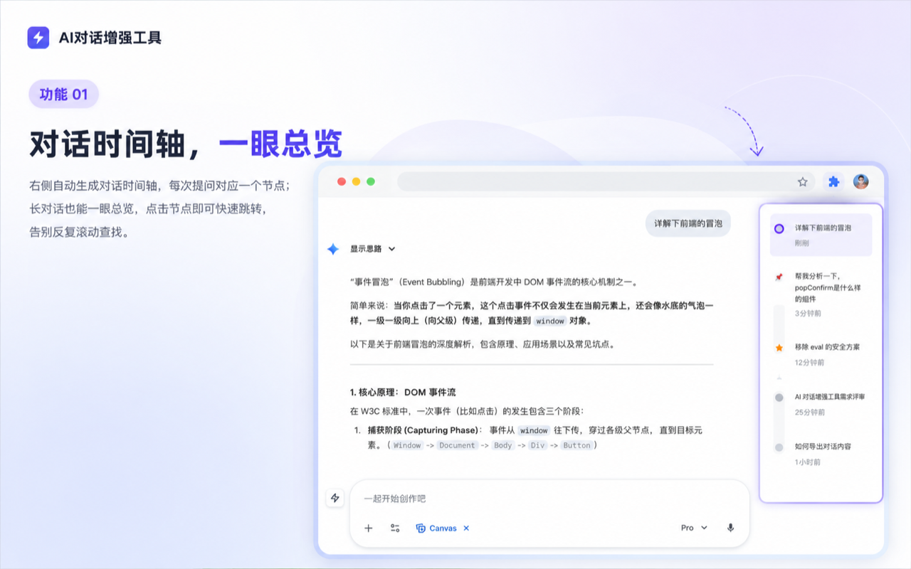
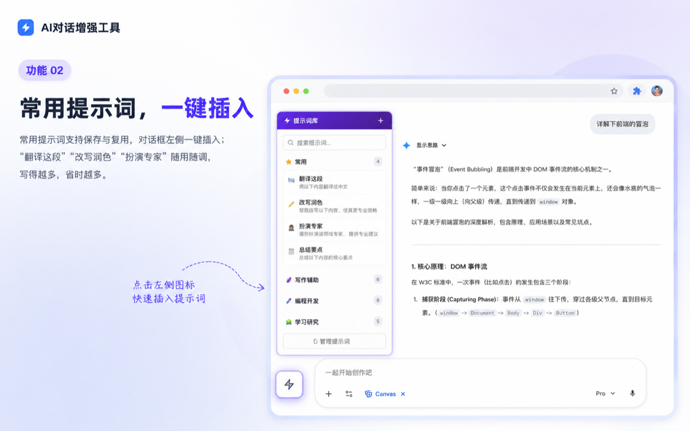
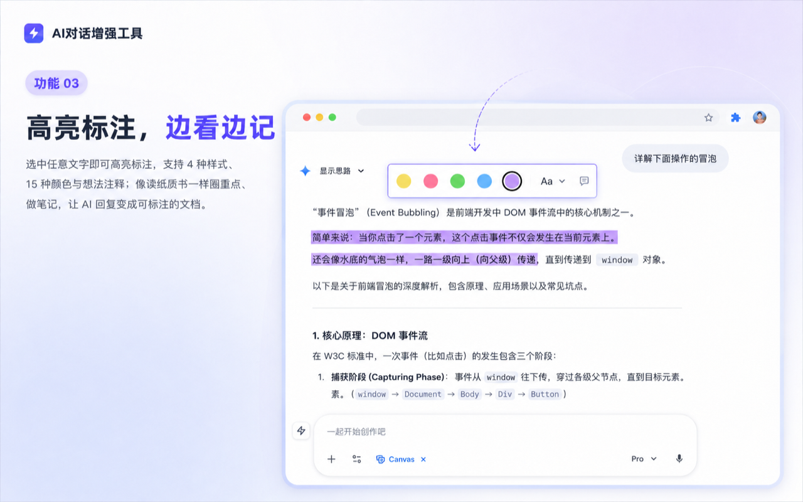
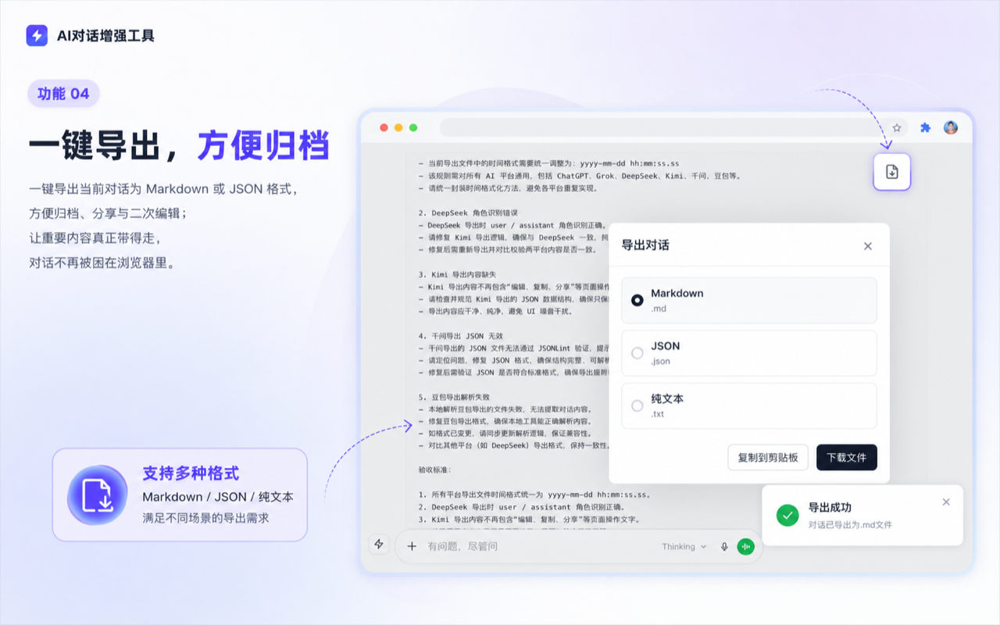

<div align="center">
  
  <h1>ChatLine</h1>
  <p><strong>让每一次 AI 对话都能快速定位、整理和带走</strong></p>
  <p>一款开源浏览器扩展，为 ChatGPT、Gemini、Claude、DeepSeek 等 AI 对话页面加入时间轴、收藏、高亮、提示词和导出能力。</p>

  <p>
    <a href="https://github.com/miguchn/ai-chatline"></a>
    <a href="https://chromewebstore.google.com/detail/chatline-ai-chat-enhanced/oiifmbmllkahpcagifgoedoiinohnfen"></a>
    <a href="https://chromewebstore.google.com/detail/chatline-ai-chat-enhanced/oiifmbmllkahpcagifgoedoiinohnfen"></a>
    <a href="https://chromewebstore.google.com/detail/chatline-ai-chat-enhanced/oiifmbmllkahpcagifgoedoiinohnfen"></a>
    <a href="./LICENSE"></a>
  </p>

  <p>
    <a href="https://chromewebstore.google.com/detail/chatline-ai-chat-enhanced/oiifmbmllkahpcagifgoedoiinohnfen"></a>
    <a href="https://github.com/miguchn/ai-chatline/issues"></a>
  </p>

  <p><strong>简体中文</strong> · <a href="./README.en.md">English</a></p>
</div>



ChatLine 直接运行在你已经使用的 AI 网站中，不需要改变对话习惯，也不需要单独注册 ChatLine 账号。安装后打开支持的平台即可使用；核心数据默认保存在浏览器本地。

## 目录

- [为什么选择 ChatLine](#why-chatline)
- [核心能力](#core-features)
- [支持平台](#supported-platforms)
- [功能截图](#screenshots)
- [快速开始](#quick-start)
- [数据与隐私](#privacy)
- [开源、贡献与路线图](#open-source)
- [本地开发](#development)
- [当前版本](#version)
- [反馈与联系](#feedback)

<a id="why-chatline"></a>

## 为什么选择 ChatLine

| 常见问题 | ChatLine 的解决方式 |
|---|---|
| 长对话只能反复滚动查找 | 自动生成对话时间轴，点击节点快速跳转 |
| 重要答案散落在不同平台 | 用收藏、文件夹、高亮和笔记统一整理 |
| 常用提示词需要重复输入 | 建立提示词库，在对话页快速插入和追问 |
| 对话难以归档或继续加工 | 导出为 Markdown / JSON，并支持本地备份 |
| 不同 AI 网站操作体验割裂 | 在多个主流 AI 平台提供一致的增强工具 |

它的差异不在于“再做一个 AI 聊天页面”，而是在原有 AI 产品之上补齐导航、整理、复用和归档能力。默认体验保持轻量，高级功能按需开启；代码公开，数据处理逻辑可审查。

<a id="core-features"></a>

## 核心能力

- **对话时间轴**：自动识别提问节点，支持跳转、重点标记和长对话回看。
- **收藏与整理**：将单条内容或对话保存到多级文件夹，并通过侧边栏快速访问。
- **高亮与笔记**：像使用荧光笔一样标注 AI 回复，添加颜色和备注，保留关键上下文。
- **提示词与快捷追问**：保存常用提示词、快速插入，并将选中内容带入下一轮提问。
- **导出、备份与恢复**：导出对话为 Markdown / JSON；扩展数据支持本地 JSON 备份，可选 Google Drive 同步。
- **可选增强工具**：智能输入、对话时间、页面宽度、LaTeX 复制、Mermaid 渲染和代码运行等功能按需启用。

> 默认开启时间轴、提示词、收藏、对话导出和高亮；代码运行、Mermaid、公式增强、电子宠物和 AI 完成提醒默认关闭。

<a id="supported-platforms"></a>

## 支持平台

ChatLine 当前覆盖 13 个 AI 对话入口。文本高亮适用于下表全部平台，其他能力会根据平台页面结构显示。

| AI 平台 | 时间轴 | 智能输入 | 对话导出 | 侧边栏文件夹 |
|---|:---:|:---:|:---:|:---:|
| ChatGPT | ✅ | ✅ | ✅ | ✅ |
| Gemini | ✅ | ✅ | ✅ | ✅ |
| DeepSeek | ✅ | ✅ | ✅ | ✅ |
| Claude | ✅ | ✅ | ✅ | ✅ |
| Kimi | ✅ | ✅ | ✅ | ✅ |
| 豆包 Doubao | ✅ | ✅ | ✅ | ✅ |
| 千问 / Qwen 国际版 | ✅ | ✅ | ✅ | ✅ |
| Grok | ✅ | ✅ | ✅ | — |
| Perplexity | ✅ | ✅ | ✅ | — |
| 元宝 Yuanbao | ✅ | ✅ | ✅ | — |
| 文心一言 | ✅ | — | ✅ | — |
| NotebookLM | — | ✅ | ✅ | — |

| 浏览器 | 安装方式 | 状态 |
|---|---|---|
| Chrome | [Chrome Web Store](https://chromewebstore.google.com/detail/chatline-ai-chat-enhanced/oiifmbmllkahpcagifgoedoiinohnfen) | 推荐 |
| Edge、Brave、Arc 等 Chromium 浏览器 | Chrome Web Store | 支持 |
| Firefox 109+ | 从源码构建并临时载入 | 测试支持，尚无官方商店版本 |

<a id="screenshots"></a>

## 功能截图

<details>
<summary><strong>查看提示词、高亮、导出与更多功能截图</strong></summary>
<br>
<table>
  <tr>
    <td width="50%"><br><sub>提示词管理：保存并快速插入常用指令</sub></td>
    <td width="50%"><br><sub>高亮与笔记：在原始上下文中保留重点</sub></td>
  </tr>
  <tr>
    <td width="50%"><br><sub>对话导出：归档、分享或继续编辑</sub></td>
    <td width="50%"><br><sub>更多增强：按需开启，不打扰默认体验</sub></td>
  </tr>
</table>
</details>

<a id="quick-start"></a>

## 快速开始

1. 从 [Chrome Web Store](https://chromewebstore.google.com/detail/chatline-ai-chat-enhanced/oiifmbmllkahpcagifgoedoiinohnfen) 安装 ChatLine。Edge、Brave、Arc 等 Chromium 浏览器也可使用同一入口。
2. 打开任一支持的 AI 平台；如果页面在安装前已经打开，请刷新一次。
3. 发起一轮对话。大多数平台会在右侧显示时间轴，闪电按钮可进入 ChatLine 功能面板。
4. 根据需要开启快捷追问、公式、Mermaid、代码运行或云备份等可选功能。

<a id="firefox-local"></a>
<details>
<summary><strong>Firefox 109+ 本地测试</strong></summary>

Firefox 目前提供源码兼容构建，适合开发和本地测试；尚未发布到 Firefox Add-ons。

```bash
git clone https://github.com/miguchn/ai-chatline.git
cd ai-chatline
node scripts/build-firefox.js
```

构建后在 `about:debugging` 中选择“临时载入附加组件”，载入生成的 `ChatLine-v4.0.0-firefox.zip`。
</details>

<a id="privacy"></a>

## 数据与隐私

- 收藏、文件夹、提示词、设置、时间标签和笔记等核心数据默认保存在浏览器本地。
- ChatLine 不主动收集、上传或分享用户的对话内容和个人信息，仓库中不包含远程采集用户数据的逻辑。
- Google Drive 同步是可选功能，只有用户主动使用云备份时才申请相应权限；本地 JSON 备份始终可用。
- 项目以 GPL-3.0 开源，任何人都可以检查数据处理和权限使用方式。

<a id="open-source"></a>

## 开源、贡献与路线图

ChatLine 的平台适配、功能实现和测试均在本仓库公开维护。欢迎通过 [Issue](https://github.com/miguchn/ai-chatline/issues) 报告问题、提出想法，或直接提交 [Pull Request](https://github.com/miguchn/ai-chatline/pulls)。

当前路线重点：

- 跟进 AI 平台页面变化，持续提升时间轴、导出和收藏的稳定性。
- 完善 Firefox 分发与跨浏览器体验。
- 改进导出、备份和数据迁移能力。
- 补充文档、测试与更多平台适配。

路线优先级会根据实际问题和社区反馈调整。提交 PR 前建议先创建或关联 Issue，并运行 `npm test`。

<a id="development"></a>

## 本地开发

ChatLine 没有复杂的前端构建步骤，可直接加载源码目录：

1. 克隆本仓库。
2. 打开 `chrome://extensions/` 或 `edge://extensions/`。
3. 启用“开发者模式”，选择“加载已解压的扩展程序”。
4. 选择仓库根目录；修改代码后重新加载扩展并刷新目标 AI 页面。
5. 运行 `npm test`，检查平台契约、安全边界、manifest 和 JavaScript 语法。

贡献时请尽量保持改动聚焦，并说明涉及的平台、浏览器和验证方式。

<a id="version"></a>

## 当前版本

### v4.0.0

- 适配新版 ChatGPT 界面与新一代 AI 浏览器（ChatGPT Atlas 等），时间轴、收藏、智能输入、对话导出全面恢复。
- 对话宽度调节改为缩放平台原生宽度变量，修复 DeepSeek 宽度设置不生效的问题。
- Perplexity 适配新版页面结构；NotebookLM 支持新域名 notebook.google.com。
- 兼容 ChatGPT 灰度期间的新旧两套界面。

### v3.9.0

- 界面文案全面更新为口语化短句，同步 19 种语言。

<a id="feedback"></a>

## 反馈与联系

- Bug 或兼容性问题：[提交 Issue](https://github.com/miguchn/ai-chatline/issues/new)
- 功能建议：[查看或创建 Issue](https://github.com/miguchn/ai-chatline/issues)
- 代码贡献：[Pull Requests](https://github.com/miguchn/ai-chatline/pulls)
- 其他联系：[miguchn@gmail.com](mailto:miguchn@gmail.com)

反馈兼容性问题时，请附上 AI 平台、浏览器版本、ChatLine 版本、复现步骤和必要截图，便于快速定位。

## 致谢与许可

ChatLine 在演进过程中参考并受益于 [Timeline](https://github.com/houyanchao/chatgpt-gemini-timeline) 开源项目。感谢原作者、社区贡献者和每一位提供反馈的用户。

本项目基于 [GNU GPL v3.0](./LICENSE) 发布。如果 ChatLine 对你有帮助，欢迎给仓库一个 Star，并把它分享给同样需要整理 AI 对话的人。
